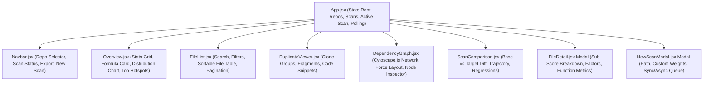

# CodeInsight Dashboard Architecture & UI Specification

## 1. Executive Architectural Overview
The **CodeInsight Frontend Dashboard** is a high-density, developer-tool web application built with **React 18** and bundled with **Vite 5**. Designed specifically following the engineering aesthetics of developer-first tools like **GitHub Insights** and **Linear**, it avoids generic AI gradients, consumer cards, and low-information decorations in favor of precise numerical telemetry, monospaced metrics, clear visual hierarchies, and actionable technical debt prioritization.

The dashboard integrates directly with the backend REST endpoints (Phases 8 & 9) to display:
- **Repository-Level Health Summaries**: Aggregated risk scores, total lines of code, complexity density, and duplicate code percentages.
- **Explainable Technical Debt Scoring**: Interactive breakdowns of the formula $R = 0.45C + 0.35D + 0.20S$ with structural sub-weights $S = 0.40L + 0.35N + 0.25P$.
- **Detailed Function-Level Diagnostics**: Cyclomatic complexity ($M = 1 + D$), maximum nesting depth ($N$), parameter count ($P$), and line ranges for every function.
- **Clustered Duplicate Code Viewer**: Multi-file clone groups with line counts, location fragments, and normalized syntax previews.
- **Interactive Topological Graph**: Cytoscape.js graph rendering source files as nodes sized by volume (LOC) and color-coded by technical debt severity.
- **Differential Scan Comparison**: Longitudinal regression tracking between scans with automated trajectory classification (`IMPROVED`, `DEGRADED`, `STABLE`).

---

## 2. Component Hierarchy & Data Flow



### Component Breakdown
| Component | Source File | Responsibilities |
| :--- | :--- | :--- |
| **`App.jsx`** | `frontend/src/App.jsx` | Manages root application state, active repository, active scan selection, background scan polling (2s interval), and modal triggers. |
| **`Navbar.jsx`** | `frontend/src/components/Navbar.jsx` | Repository switcher dropdown, real-time scan status badge, multi-format export dropdown (`JSON`, `Markdown`, `CSV`), and "New Scan" modal launcher. |
| **`Overview.jsx`** | `frontend/src/components/Overview.jsx` | High-level summary metrics, $R = 0.45C + 0.35D + 0.20S$ formula banner, Recharts distribution bar chart, top debt hotspots table, and actionable recommendations. |
| **`FileList.jsx`** | `frontend/src/components/FileList.jsx` | Interactive source file table with real-time text search, severity/language filters, multi-column sorting (risk, lines, complexity), pagination, and detail inspector launcher. |
| **`FileDetail.jsx`** | `frontend/src/components/FileDetail.jsx` | Modal dialog inspecting an individual file: formula sub-scores ($C, D, S, L, N, P$), weighted points breakdown, explicit risk factors, and full function metrics table. |
| **`DuplicateViewer.jsx`** | `frontend/src/components/DuplicateViewer.jsx` | Clone cluster inspector: search filter, min-line threshold selector, accordion cards with participating file fragments, and normalized syntax blocks. |
| **`DependencyGraph.jsx`** | `frontend/src/components/DependencyGraph.jsx` | Cytoscape.js interactive graph: node sizing by LOC, color-coding by risk severity, force-directed CoSE layout, zoom/pan controls, and node selection sidebar. |
| **`ScanComparison.jsx`** | `frontend/src/components/ScanComparison.jsx` | Longitudinal regression analysis: base vs target scan selectors, overall health trajectory badge, delta metric cards, and degraded vs improved file tables. |
| **`NewScanModal.jsx`** | `frontend/src/components/NewScanModal.jsx` | Scan trigger modal: existing repo select or new path registration, configurable risk weights ($w_c, w_d, w_s$), and synchronous vs async background queue selector. |

---

## 3. Design System & Typography Tokens

The UI follows strict design tokens defined in `frontend/src/index.css`:

### Color Palette (Dark Theme)
- **Canvas Background**: `#090d16`
- **Surface / Card Background**: `#0f172a`
- **Subtle / Table Background**: `#1e293b`
- **Hover State**: `#334155`
- **Border Color**: `#1e293b`
- **Primary Text**: `#f8fafc`
- **Secondary Text**: `#94a3b8`
- **Muted Text**: `#64748b`
- **Accent Blue**: `#38bdf8`

### Severity Color Tokens
| Severity | Score Range | Badge Color | Background Tint |
| :--- | :--- | :--- | :--- |
| **`LOW`** | 0 – 24 | `#10b981` (Emerald) | `rgba(16, 185, 129, 0.12)` |
| **`MODERATE`** | 25 – 49 | `#f59e0b` (Amber) | `rgba(245, 158, 11, 0.12)` |
| **`HIGH`** | 50 – 74 | `#f97316` (Orange) | `rgba(249, 115, 22, 0.12)` |
| **`CRITICAL`** | 75 – 100 | `#ef4444` (Rose / Red) | `rgba(239, 68, 68, 0.14)` |

### Typography
- **Prose & Labels**: `Plus Jakarta Sans`, 400/500/600/700.
- **Code & Numbers**: `JetBrains Mono`, 400/500/600 (used for all numeric scores, paths, line numbers, and formulas).

---

## 4. Formula Visualization & Explainability

The platform renders the user's exact technical debt risk score formulation:

$$\boxed{R = 0.45C + 0.35D + 0.20S}$$

where the structural risk score is decomposed as:

$$\boxed{S = 0.40L + 0.35N + 0.25P}$$

In the `FileDetail` and `Overview` views, each component is presented with its normalized sub-score (0–100) and its exact contribution in points:
1. **$C$ (Complexity, 45%)**: Function decision paths via AST. Max function complexity converted via thresholds ($1\text{--}5 \to 10$, $6\text{--}10 \to 35$, $11\text{--}15 \to 65$, $>15 \to 90$).
2. **$D$ (Duplication, 35%)**: Duplicated line percentage converted via thresholds ($0\% \to 0$, $1\text{--}5\% \to 20$, $6\text{--}10\% \to 40$, $11\text{--}20\% \to 70$, $>20\% \to 90$).
3. **$S$ (Structural Risk, 20%)**: Weighted synthesis of file length ($L$, 40%), deep nesting depth ($N$, 35%), and parameter count ($P$, 25%).

---

## 5. Build, Bundling & Dual-Mode Deployment

### 1. Development Mode (Vite HMR)
During development, the frontend runs via Vite dev server on port `3000`:
```bash
npm run dev --prefix frontend
```
- Full Hot Module Replacement (HMR).
- API requests to `/api/*` are transparently proxied to the backend at `http://localhost:5000` via `frontend/vite.config.js`.

### 2. Production Build & Optimized Chunking
The production build compiles modern ES modules into `frontend/dist`:
```bash
npm run build --prefix frontend
```
Rollup `manualChunks` divides third-party libraries into independent bundles:
- `vendor-charts`: Recharts charting engine (~499 kB).
- `vendor-graph`: Cytoscape.js graph layout engine (~443 kB).
- `vendor-icons`: Lucide React icon symbols (~20 kB).
- `vendor-react`: React & ReactDOM runtime.
- `index`: Core application logic (~72 kB).

### 3. Integrated Single-Server Mode
The Node.js Express backend (`backend/src/server.js`) automatically detects `frontend/dist` and serves both the compiled single-page application and the REST API from a single port (`http://localhost:5000`):
- `GET /api/*` $\to$ Handled by REST controllers.
- `GET /*` $\to$ Serves `frontend/dist/index.html` with client-side SPA routing support.

