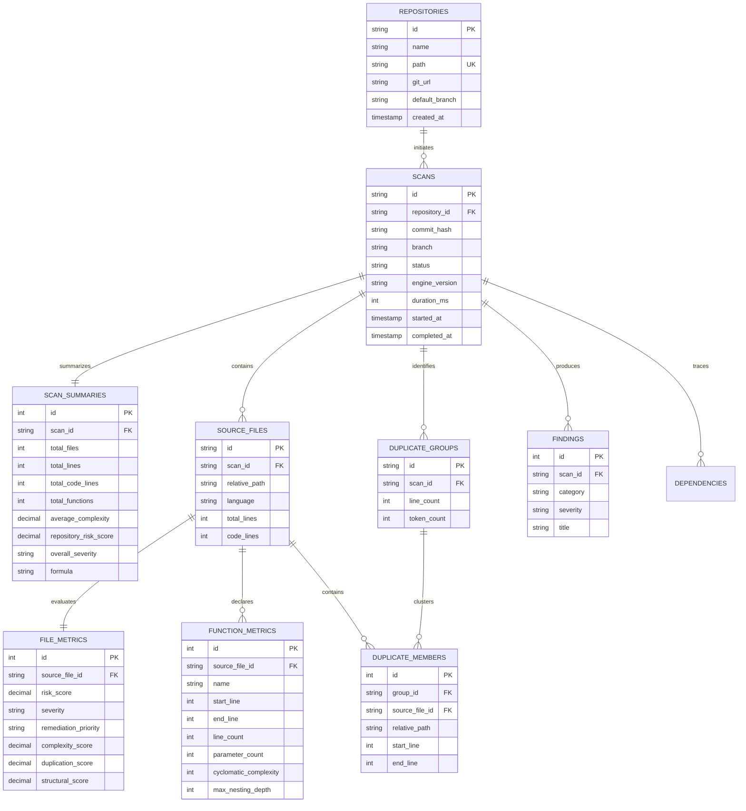

# CodeInsight PostgreSQL Database Specification

This document details the relational architecture, database schema, entity relationships, indexes, and transactional guarantees implemented in **Phase 9** for PostgreSQL 18.

---

## 1. Entity-Relationship Overview



---

## 2. Table Definitions

### 1. `repositories`
Tracks registered code repositories and their root paths on disk or Git URLs.
- **`id`** (`VARCHAR(64) PRIMARY KEY`): Unique repository identifier.
- **`path`** (`TEXT UNIQUE NOT NULL`): Absolute filesystem path.
- **`name`** (`VARCHAR(255) NOT NULL`): Human-readable repository title.
- **`git_url`** (`TEXT`): Remote clone URL if applicable.
- **`default_branch`** (`VARCHAR(100)`): Main branch identifier.

### 2. `scans`
Records individual static analysis runs tied to a repository and commit hash.
- **`id`** (`VARCHAR(64) PRIMARY KEY`): Unique scan identifier.
- **`repository_id`** (`VARCHAR(64) NOT NULL REFERENCES repositories(id) ON DELETE CASCADE`): Target repo.
- **`commit_hash`** (`VARCHAR(64)`): Git revision hash when available.
- **`status`** (`VARCHAR(32)`): Lifecycle state (`queued`, `running`, `completed`, `failed`).
- **`duration_ms`** (`INTEGER`): Processing duration in milliseconds.

### 3. `scan_summaries`
One-to-one executive summary for each completed scan.
- Stores total lines, code lines, function counts, duplication lines, and aggregate risk score.
- **`formula`** (`VARCHAR(100)`): Records the exact formula used (e.g. `R = 0.45*C + 0.35*D + 0.20*S`).
- **`risk_distribution`** (`JSONB`): Severity histogram `{ LOW, MODERATE, HIGH, CRITICAL }`.

### 4. `source_files`
Every analyzed source file discovered during scan traversal.
- **`id`** (`VARCHAR(64) PRIMARY KEY`): Unique file ID.
- **`scan_id`** (`VARCHAR(64) NOT NULL REFERENCES scans(id) ON DELETE CASCADE`).
- **`relative_path`** (`TEXT NOT NULL`): Relative path within repo.
- **`language`** (`VARCHAR(64)`): Identified programming language (`cpp`, `javascript`, `typescript`).
- **`total_lines`**, **`code_lines`**, **`comment_lines`**, **`blank_lines`**, **`max_line_length`**.
- Constraint: `UNIQUE (scan_id, relative_path)`.

### 5. `file_metrics`
Detailed dimensional sub-scores and technical debt calculations for each source file:
- **`complexity_score`** ($C$, 45% weight)
- **`duplication_score`** ($D$, 35% weight)
- **`structural_score`** ($S$, 20% weight, with $L$, $N$, $P$ components)
- **`risk_score`** ($R = 0.45C + 0.35D + 0.20S$)
- **`severity`** (`LOW`, `MODERATE`, `HIGH`, `CRITICAL`)
- **`remediation_priority`** (`P1`, `P2`, `P3`, `P4`)
- **`risk_factors`** (`JSONB`): Human-readable triggers.
- **`contributing_metrics`** (`JSONB`): Dimensional percentage impact array.

### 6. `function_metrics`
Individual function and method AST metrics extracted by Tree-sitter / Babel:
- **`name`**, **`start_line`**, **`end_line`**, **`line_count`**
- **`parameter_count`**: Formal parameter count.
- **`cyclomatic_complexity`**: McCabe complexity ($M = 1 + D$).
- **`max_nesting_depth`**: Peak block indentation depth.
- **`is_high_complexity`**: Flag for functions where $M > 10$.

### 7. `duplicate_groups` & `duplicate_members`
Normalizes Type-1 code clone clusters:
- `duplicate_groups`: Group ID, duplicated line span, token count, sample code snippet.
- `duplicate_members`: Exact start and end line coordinates of each file instance in the clone group.

### 8. `dependencies`
Tracks static `#include` and `import` / `require` relationships for dependency graph visualization.

### 9. `findings`
Identified hotspots and actionable recommendations generated by CodeInsight.

---

## 3. Database Indexes

High-performance B-tree indexes are created to optimize filtering, sorting, and joins:
```sql
CREATE INDEX idx_scans_repo ON scans(repository_id);
CREATE INDEX idx_scans_status ON scans(status);
CREATE INDEX idx_source_files_scan ON source_files(scan_id);
CREATE INDEX idx_source_files_path ON source_files(scan_id, relative_path);
CREATE INDEX idx_file_metrics_risk ON file_metrics(risk_score DESC);
CREATE INDEX idx_file_metrics_sev ON file_metrics(severity);
CREATE INDEX idx_function_metrics_file ON function_metrics(source_file_id);
CREATE INDEX idx_function_metrics_comp ON function_metrics(cyclomatic_complexity DESC);
CREATE INDEX idx_dup_members_group ON duplicate_members(group_id);
CREATE INDEX idx_findings_scan ON findings(scan_id);
```

---

## 4. Transactional Guarantees

Every scan persistence operation uses **ACID Transactions**:
```sql
BEGIN;
  -- Insert/update repository
  -- Insert scan header
  -- Insert scan summary
  -- Batch insert source_files
  -- Batch insert file_metrics
  -- Batch insert function_metrics
  -- Batch insert duplicate_groups & duplicate_members
  -- Insert findings
COMMIT;
```
If any error occurs during ingestion, the entire transaction is rolled back (`ROLLBACK`), preventing partial or corrupted scan states.
Cascading foreign keys (`ON DELETE CASCADE`) ensure that deleting a scan or repository cleans up all associated child records automatically.

